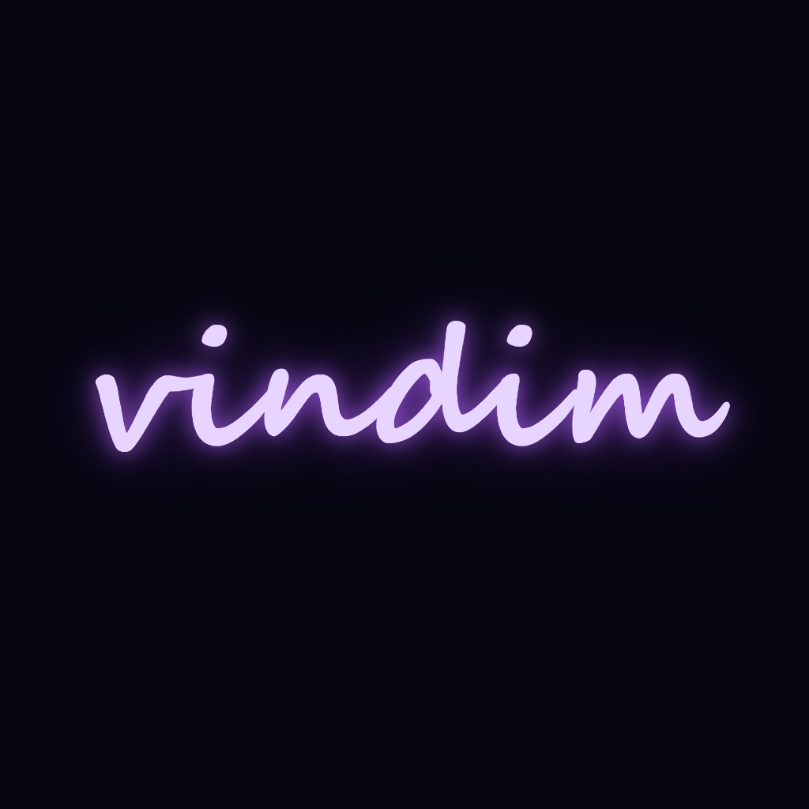

<div align="center">

<!-- МЕСТО ДЛЯ ЛОГОТИПА -->
<!-- 
  ИНСТРУКЦИЯ:
  1. Закинь картинку с логотипом в корень репозитория и назови её logo.png
  2. Раскомментируй строку ниже (убери <!-- и -->)


<br>

<h1>
  <span style="background: linear-gradient(135deg, #e8d5ff, #a855f7); -webkit-background-clip: text; -webkit-text-fill-color: transparent; font-family: 'Segoe Script', cursive; font-size: 60px;">
    vindim
  </span>
</h1>

<p><b>Экосистема интерактивных веб-проектов.</b></p>

<p>
  
  
  
  
  
</p>

</div>

---

## 🚀 О проекте

Добро пожаловать в **vindim** — коллекцию экспериментов с графикой, физикой и звуком прямо в браузере. Здесь нет тяжёлых фреймворков, только чистый код, магия WebGL и немного безумия.

> ⚠️ **Важно:** Все проекты созданы с помощью искусственного интеллекта.  
> **vindim** — это выдуманная корпорация, которой не существует в реальном мире.

---

## 📦 Наши проекты

<table>
  <tr>
    <td width="50%" align="center">
      <h3>☀️ Уничтожение солнца</h3>
      <p>Кинематографичный 3D-фильм-катастрофа.<br>Почувствуй мощь лазера и гибель вселенной.</p>
      <a href="https://vadimtychkov17-a11y.github.io/sun-game/"><b>▶ ЗАПУСТИТЬ</b></a>
    </td>
    <td width="50%" align="center">
      <h3>🎵 Аудио Визуализатор</h3>
      <p>100 уникальных режимов, Web Audio API,<br>запись видео и пиксельный глитч.</p>
      <a href="https://vadimtychkov17-a11y.github.io/visualizer/"><b>▶ ЗАПУСТИТЬ</b></a>
    </td>
  </tr>
  <tr>
    <td colspan="2" align="center">
      <br>
      <h3>👆 VinClick <i>(Самый новый продукт)</i></h3>
      <p>Затягивающий кликер с престижем, золотыми кнопками,<br>комбо-системой и оффлайн-доходом. Начни зарабатывать очки.</p>
      <a href="https://vadimtychkov17-a11y.github.io/clicker/"><b>▶ ЗАПУСТИТЬ</b></a>
      <br><br>
    </td>
  </tr>
</table>

---

## 🛠 Технические особенности

- **Liquid Glass Design**: Интерфейсы с эффектом матового стекла, мягкими свечениями и глубокими тенями.
- **3D-графика на лету**: Использование библиотеки `Three.js` для симуляции плазмы, теней и пост-обработки (Bloom).
- **Звук без файлов**: Генерация всех звуков через `Web Audio API` (синтезаторы, басы, шумы).
- **Адаптивность**: Полная поддержка мобильных устройств, планшетов и ПК.
- **Хранение данных**: Сохранение прогресса и настроек через `localStorage`.

---

## 📂 Структура репозитория

```text
vadimtychkov17-a11y.github.io/
├── index.html             # Главный лаунчер проектов
├── cover1.PNG             # Обложка "Уничтожение солнца"
├── cover2.PNG             # Обложка "Аудио визуализатор"
├── cover3.PNG             # Обложка "VinClick"
├── logo.png               # Логотип vindim (если добавишь)
├── favicon.ico            # Иконка сайта
├── sun-game/              # Исходники 3D-фильма
├── visualizer/            # Исходники визуализатора
└── clicker/               # Исходники кликера
