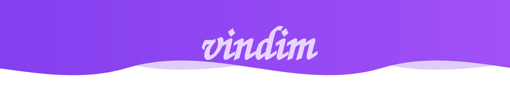

<div align="center">
  <!-- Твоя анимированная плашка с волнами и текстом -->
  
  
  <br><br>

  <p><b>Экосистема интерактивных веб-проектов.</b></p>

  <p>
    
    
    
    
    
  </p>
</div>

---

## 🗺️ Навигация

- [О проекте](#-о-проекте)
- [Наши проекты](#-наши-проекты)
- [Технические особенности](#-технические-особенности)
- [Структура репозитория](#-структура-репозитория)
- [Быстрый старт](#-быстрый-старт)
- [Планы на будущее](#-планы-на-будущее)

---

## 🚀 О проекте

Добро пожаловать в **vindim** — коллекцию экспериментов с графикой, физикой и звуком прямо в браузере. Здесь нет тяжёлых фреймворков, только чистый код, магия WebGL и немного безумия.

> ⚠️ **Важно:** Все проекты созданы с помощью искусственного интеллекта.  
> **vindim** — это выдуманная корпорация, которой не существует в реальном мире.

---

## 📦 Наши проекты

<table>
  <tr>
    <td width="50%" align="center" valign="top">
      <br><br>
      <h3>☀️ Уничтожение солнца</h3>
      <p>Кинематографичный 3D-фильм-катастрофа. Почувствуй мощь лазера и гибель вселенной.</p>
      <a href="https://vadimtychkov17-a11y.github.io/sun-game/">
        
      </a>
    </td>
    <td width="50%" align="center" valign="top">
      <br><br>
      <h3>🎵 Аудио Визуализатор</h3>
      <p>100 уникальных режимов, Web Audio API, запись видео и пиксельный глитч.</p>
      <a href="https://vadimtychkov17-a11y.github.io/visualizer/">
        
      </a>
    </td>
  </tr>
  <tr>
    <td colspan="2" align="center" valign="top">
      <br>
      
      <h3>👆 VinClick</h3>
      <p>Затягивающий кликер с престижем, золотыми кнопками, комбо-системой и оффлайн-доходом.</p>
      <a href="https://vadimtychkov17-a11y.github.io/clicker/">
        
      </a>
      <br><br>
    </td>
  </tr>
</table>

---

## 🛠 Технические особенности

<table>
  <tr>
    <td width="50%" valign="top">
      <h4>🎨 Liquid Glass Design</h4>
      <p>Интерфейсы с эффектом матового стекла, мягкими свечениями, градиентами и глубокими тенями, вдохновлённые iOS.</p>
    </td>
    <td width="50%" valign="top">
      <h4>🌌 3D-графика на лету</h4>
      <p>Использование библиотеки <code>Three.js</code> для симуляции плазмы, реалистичного света, теней и пост-обработки (Bloom).</p>
    </td>
  </tr>
  <tr>
    <td width="50%" valign="top">
      <h4>🔊 Звук без файлов</h4>
      <p>Генерация всех звуков (клики, взрывы, фоновый эмбиент) через <code>Web Audio API</code>. Никаких внешних mp3.</p>
    </td>
    <td width="50%" valign="top">
      <h4>📱 Адаптивность и Оптимизация</h4>
      <p>Полная поддержка мобильных устройств, планшетов и ПК. Плавная работа до 60 FPS даже на слабых устройствах.</p>
    </td>
  </tr>
  <tr>
    <td width="50%" valign="top">
      <h4>💾 Хранение данных</h4>
      <p>Сохранение игрового прогресса, рекордов и настроек через <code>localStorage</code>. Оффлайн-доход в кликере.</p>
    </td>
    <td width="50%" valign="top">
      <h4>✨ Чистый код</h4>
      <p>Отсутствие тяжёлых фреймворков (React, Vue). Всё написано на чистом Vanilla JS, HTML и CSS.</p>
    </td>
  </tr>
</table>

---

## 📂 Структура репозитория

```text
vadimtychkov17-a11y.github.io/
│
├── 📁 sun-game/           # 3D-игра "Уничтожение солнца"
│   └── index.html         # Исходный код игры
│
├── 📁 visualizer/         # Аудио визуализатор
│   └── index.html         # Исходный код визуализатора
│
├── 📁 clicker/            # Кликер VinClick
│   └── index.html         # Исходный код кликера
│
├── 📄 index.html          # Главный лаунчер (выбор проектов)
├── 🖼️ cover1.PNG          # Обложка для "Уничтожение солнца"
├── 🖼️ cover2.PNG          # Обложка для "Аудио визуализатор"
├── 🖼️ cover3.PNG          # Обложка для "VinClick"
├── 🖼️ header.svg          # Анимированная шапка с логотипом
├── 🖼️ favicon.ico         # Иконка сайта
├── 📜 LICENSE             # Лицензия MIT
└── 📖 README.md           # Этот файл
