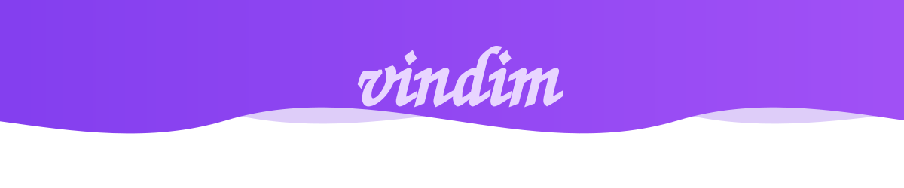

<div align="center">
  <!-- Твоя анимированная плашка с волнами и текстом -->
  
  
  <br><br>

  <p><b>Экосистема интерактивных веб-проектов.</b></p>

  <p>
    
    
    
    
    
  </p>
</div>

---

## 🗺️ Навигация

- [О проекте](#-о-проекте)
- [Наши проекты](#-наши-проекты)
- [Технические особенности](#-технические-особенности)
- [Скриншоты](#-скриншоты)
- [Структура репозитория](#-структура-репозитория)
- [Быстрый старт](#-быстрый-старт)
- [Планы на будущее](#-планы-на-будущее)

---

## 🚀 О проекте

Добро пожаловать в **vindim** — коллекцию экспериментов с графикой, физикой и звуком прямо в браузере. Здесь нет тяжёлых фреймворков, только чистый код, магия WebGL и немного безумия.

> ⚠️ **Важно:** Все проекты созданы с помощью искусственного интеллекта.  
> **vindim** — это выдуманная корпорация, которой не существует в реальном мире.

---

## 📦 Наши проекты

<table>
  <tr>
    <td width="50%" align="center" valign="top">
      
      <h3>🧩 Геометрический Тетрис</h3>
      <p>Классика в неоновом стиле. 7 фигур, 10 уровней скорости и процедурные звуки.</p>
      <a href="https://vadimtychkov17-a11y.github.io/tetris/">
        
      </a>
    </td>
    <td width="50%" align="center" valign="top">
      
      <h3>👆 VinClick</h3>
      <p>Кликер, который затянет тебя на часы. Зарабатывай, покупай и перерождайся.</p>
      <a href="https://vadimtychkov17-a11y.github.io/clicker/">
        
      </a>
    </td>
  </tr>
  <tr>
    <td colspan="2" align="center" valign="top">
      <br>
    </td>
  </tr>
  <tr>
    <td width="50%" align="center" valign="top">
      
      <h3>🎵 Аудио Визуализатор</h3>
      <p>Есть баги не злись. 100 режимов, запись видео и пиксели.</p>
      <a href="https://vadimtychkov17-a11y.github.io/visualizer/">
        
      </a>
    </td>
    <td width="50%" align="center" valign="top">
      
      <h3>☀️ Уничтожение солнца</h3>
      <p>Там есть баг когда прыгаешь пушка снова запускается, не прыгай!</p>
      <a href="https://vadimtychkov17-a11y.github.io/sun-game/">
        
      </a>
    </td>
  </tr>
</table>

---

## 🛠 Технические особенности

<table>
  <tr>
    <td width="50%" valign="top">
      <h4>🎨 Liquid Glass Design</h4>
      <p>Интерфейсы с эффектом матового стекла, мягкими свечениями, градиентами и глубокими тенями, вдохновлённые iOS.</p>
    </td>
    <td width="50%" valign="top">
      <h4>🌌 3D-графика на лету</h4>
      <p>Использование библиотеки Three.js для симуляции плазмы, реалистичного света, теней и пост-обработки (Bloom).</p>
    </td>
  </tr>
  <tr>
    <td width="50%" valign="top">
      <h4>🔊 Звук без файлов</h4>
      <p>Генерация всех звуков (клики, взрывы, фоновый эмбиент) через Web Audio API. Никаких внешних mp3.</p>
    </td>
    <td width="50%" valign="top">
      <h4>📱 Адаптивность и Оптимизация</h4>
      <p>Полная поддержка мобильных устройств, планшетов и ПК. Плавная работа до 60 FPS даже на слабых устройствах.</p>
    </td>
  </tr>
  <tr>
    <td width="50%" valign="top">
      <h4>💾 Хранение данных</h4>
      <p>Сохранение игрового прогресса, рекордов и настроек через localStorage. Оффлайн-доход в кликере.</p>
    </td>
    <td width="50%" valign="top">
      <h4>✨ Чистый код</h4>
      <p>Отсутствие тяжёлых фреймворков (React, Vue). Всё написано на чистом Vanilla JS, HTML и CSS.</p>
    </td>
  </tr>
</table>

---

## 📂 Структура репозитория

```text
vadimtychkov17-a11y.github.io/
│
├── 📁 tetris/             # Геометрический Тетрис (Самый новый)
│   └── index.html         # Исходный код игры
│
├── 📁 clicker/            # Кликер VinClick (Будут обновления)
│   └── index.html         # Исходный код кликера
│
├── 📁 visualizer/         # Аудио визуализатор
│   └── index.html         # Исходный код визуализатора
│
├── 📁 sun-game/           # 3D-игра "Уничтожение солнца" (Старое)
│   └── index.html         # Исходный код игры
│
├── 📄 index.html          # Главный лаунчер (выбор проектов)
├── 🖼️ cover1.PNG          # Обложка "Уничтожение солнца"
├── 🖼️ cover2.PNG          # Обложка "Аудио визуализатор"
├── 🖼️ cover3.PNG          # Обложка "VinClick"
├── 🖼️ cover4.PNG          # Обложка "Геометрический Тетрис"
├── 🖼️ header.svg          # Анимированная шапка с логотипом
├── 🖼️ favicon.ico         # Иконка сайта
├── 📜 LICENSE             # Лицензия MIT
└── 📖 README.md           # Этот файл
```

---

## ⚡ Быстрый старт

Все проекты работают прямо в браузере. Вы можете просто открыть `index.html` в корне репозитория.

Если вы хотите запустить проект локально (например, для доработки кода):

1. Клонируйте репозиторий:
   ```bash
   git clone https://github.com/vadimtychkov17-a11y/vadimtychkov17-a11y.github.io.git
   ```
   
2. Перейдите в папку проекта:
   ```bash
   cd vadimtychkov17-a11y.github.io
   ```
   
3. Откройте `index.html` в вашем браузере или запустите локальный сервер:
   ```bash
   python -m http.server 8000
   ```

---

## 🗺 Планы на будущее

- [ ] Обновить VinClick (добавить новые механики и апгрейды).
- [ ] Добавить больше обложек и режимов для визуализатора.
- [ ] Оптимизировать 3D-сцену для мобильных устройств (снизить нагрузку на GPU).
- [ ] Добавить мультиязычность (English / Русский).

---

<div align="center">
  <p>Сделано с ❤️ и долей безумия.<br>
  <b>vindim</b> © 2026. Все проекты созданы ИИ.</p>
</div>
